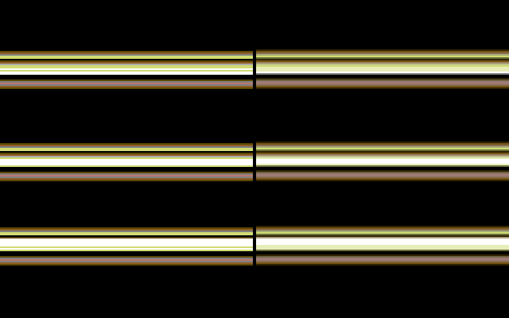

# RAYBARS: ray-traced raster bars for the C64

Three chrome cylinders orbit the screen's X axis. Each one is shaded every
frame with a diffuse term, a 1-D environment map and a Phong specular
highlight from a single point light. The CPU only has to write one
register per scanline, so almost all of its time goes to the shading maths.



## Build and run

```sh
python3 gen_tables.py                                   # optional: tables.inc and ramps.inc are committed
cl65 -t none -C raybars.cfg -o raybars.prg raybars.s   # STYLE=2 (default) gold; --asm-define STYLE=0 or 1 for the shaded looks
x64sc raybars.prg                                        # VICE, PAL machine
```

`simulate.py` runs the real binary's per-frame tracer on an emulated 6502
(`pip install py65 pillow`, and build with `-g -Ln raybars.lbl`). It checks
the cycle budget and the 63-cycle raster loop, and renders `preview.gif` and
`preview.png`. The GIF's left half shows the raw scanlines. The right half
roughly approximates how a PAL TV blends neighbouring lines. The preview
uses VICE's default palette, the one the article uses.

## How it works, step by step

1. **A raster bar is a cylinder seen side-on.** In the y/z plane each scanline
   `i` of a bar with radius `R` is a point on a circle, and its normal is at
   angle `t_i` where `sin t_i = (i + 0.5 - R) / R`. That depends only on `i`,
   so the normals of every bar make up one constant 32-byte table.
2. **The camera is at infinity (orthographic).** The view vector is always
   `(0,0,1)`, so there is no perspective divide and V never needs computing.
3. **Angles are stored in brads** (256 to a circle). Sums of angles wrap
   naturally in 8 bits, and every trig function is a 256-byte table.
4. **The lighting reduces to sums of angles.** With the light at angle `p`:
   * diffuse: `N·L = cos(t − p)`
   * specular: the reflected light, dotted with V, raised to the power n, which is `cos(2t − p)^n`
   * environment: the reflected view ray points at angle `2t`, so the lookup is `env[2t + spin]`
5. **The light uses a log-table atan2.** There is one light, at fixed depth
   `LZ = 100`. The bars orbit with |y| ≤ 64 and |z| ≤ 40, and the light bobs
   ±44, so `dy` always fits in a signed byte and `dz` is always 60..140. Then
   `atan(dy/dz) = atan(2^(log2 dy − log2 dz))`, which turns the division into
   a subtraction. It is evaluated once per bar, at the bar's axis, which
   works because R = 16 is small next to the light distance.
6. **Indexing uses doubled, page-aligned tables.** The tables are 512 bytes
   each, so `table[t − p]` becomes `lda table+(−p),x`, with `−p` patched into
   the operand once per bar. The inner loop takes about 39 cycles per
   scanline.
7. **Colour uses a stretched palette.** This follows Daniel Krajzewicz's
   [Stretching the c64 Palette](https://www.krajzewicz.de/blog/stretching-the-c64-palette.php).
   * **Multichrome ramps.** Each ramp takes one colour from each of the
     VIC-II's brightness levels, whatever its hue, so it gets every
     brightness step the chip has. These are three of the article's
     gradients, with their white end dropped:
     * Ocean: blue, dark grey, purple, light blue, cyan, light green
     * Forest: brown, dark grey, orange, green, light grey, light green
     * Dusk: blue, dark grey, purple, light red, cyan, yellow
   * **`STYLE=2` (default): the gold bar.** No shading of the bar colours
     at all. Each bar is 24 lines with a fixed hand-picked gold pattern, one
     colour per scanline, top to bottom:
     `9 8 12 7 7 0 9 8 15 7 7 1 7 1 7 0 0 0 9 12 10 12 8 9`.
     It works like a fixed environment map, so it doesn't shift as the bar
     moves. Only the white specular highlight is traced on top. Where the
     highlight is faint, white replaces gold on every other line
     (yellow/white alternating blends to light yellow). Where it is strong,
     it's solid white. The highlight covers every line, the black ones
     included. This style uses about 48% of the vblank.
   * **`STYLE=0`: dithering only where white used to be.** The
     bar's own colours are solid bands. Between the brightest bar colour
     and the white highlight, the two alternate on even and odd scanlines
     (the article's "Poor Man's Dithering"), which a PAL TV blends. The
     shading loop is unrolled by two, so even and odd lines read their own
     ramp table. `FLICKER=1` also swaps the pair every frame, which looks
     smoother on a sharp LCD or emulator but flickers.
   * **`STYLE=1`: the article's "scaled split".** Two lines of colour,
     then one black line, counted outwards from each bar's centre. The
     black lines belong to the bar, so they also cover the bars behind it.
   * **Correct widths.** The article notes that hand-made patterns never
     give each brightness its correct width. Here the widths come from the
     cosine shading, so the bars actually look round.
   * **Intensity** is diffuse (0..14) + env (0..2) + specular (0..8).
     Diffuse plus env tops out at 16, the brightest bar colour, so only the
     specular term reaches **white**.
8. **Bars are drawn back to front.** A 3-element sorting network orders them
   by depth, and the painter's algorithm handles the crossings.
9. **The screen is blanked (DEN=0).** With the display off there are no
   badlines, so after a double-IRQ stable raster the display is a plain
   63-cycle loop writing `$d020`, and the whole screen is border. The tracer
   uses about 5,000 of the roughly 6,800 vblank cycles (73%).

## GOLDTILT: one slanted gold bar

`goldtilt.s` is a separate program: one gold bar that bobs up and down and
rocks like a see-saw.

```sh
cl65 -t none -C raybars.cfg -o goldtilt.prg goldtilt.s
python3 sim_goldtilt.py      # needs -g -Ln goldtilt.lbl; renders preview_goldtilt.gif
```

* **Splitting each line.** A raster bar normally can't slant, because the
  colour only changes where the CPU writes `$d020`. Here every line of the
  bar is split into 6 segments. Each split is `lda #c / sta $d020 / nop`,
  8 cycles or 64 pixels, so 6 segments cover the whole 384-pixel visible
  line. The fastest possible split is 6 cycles (48 pixels), but six of
  those would only cover 288 pixels, leaving the last segment stretched.
* **The slant.** Segment *k* is drawn shifted down by `off_k` = 0..5
  lines, so the bar becomes a staircase that reads as one slanted bar. The
  slope follows `off_k = round(2.5 + (k - 2.5) * sin(tilt))`.
* **Black padding.** The gold column gets 6 black rows above and 6 below,
  so every segment is the same 36-entry column read at a different shift:
  `colour(row r, segment k) = column[r + 6 - off_k]`.
* **Speedcode.** The 30 display rows are unrolled code with no branches,
  exactly 63 cycles per row. Each frame, an unrolled patcher rewrites the
  180 `lda #` values in it.
* **The rest of the screen** is black, so the stable double IRQ simply
  fires 2 lines above wherever the bar is. The per-frame work uses at most
  about 16% of the time before the next IRQ.
* **The highlight** is traced exactly as in `STYLE=2`. Its dither follows
  each segment's own screen lines.
* **Horizontal position.** Where the splits land across the screen depends
  on exact cycle timing that only a real C64 or VICE shows. Use `HTUNE` to
  slide them so the first split falls in the horizontal blank.

## GOLDLIGHT: the slanted bar with a visible light

`goldlight.s` adds the light source as a glowing ball sprite that sweeps
back and forth above the bar. The bar's highlight is thickest in the
segment nearest the ball.

```sh
cl65 -t none -C raybars.cfg -o goldlight.prg goldlight.s
python3 sim_goldlight.py     # needs -g -Ln goldlight.lbl; renders preview_goldlight.gif
```

* **A sprite without badlines.** With DEN=0 the border covers everything,
  sprites included. But badlines are only enabled if DEN is set during
  raster line $30. So a small IRQ at line 44 clears DEN across line $30 and
  sets it again before line $33, where the display window opens. The window
  opens with no badlines all frame (idle state, `$3fff` = 0).
* **Two registers per split.** Inside the window the colour comes from
  `$d021`, so every split writes both registers:
  `lda #c / sta $d020 / sta $d021` = 10 cycles = 80 pixels. That gives 5
  segments with offsets 0..4.
* **Sprite timing.** A sprite only steals cycles on the lines where it's
  drawn. The ball stays above the bar and never shares a raster line with
  the speedcode or its stabilising IRQ (the simulator checks every frame),
  so every row stays exactly 63 cycles.
* **The highlight per segment.** For a cylinder along x lit by a point
  light at horizontal distance *a*,
  `spec = ((rho / sqrt(rho^2 + a^2)) * cos(2t - p))^n`, so it is strongest
  under the light and falls off sideways. That is approximated as
  "subtract |a|/32 levels" per segment. As the light sweeps, the white
  goes from about 7 lines under the ball down to the gold pattern's own 2.
* **The ball** is a multicolour sprite: white core, yellow, orange rim. It
  is copied to `$3F00`, because in VIC bank 0 the range `$1000`-`$1FFF`
  shows character ROM.
* **Cost.** The per-frame work uses at most about 59% of the time before
  the top IRQ.
* **Untested on hardware.** Exactly where the splits land relative to
  the sprite's x position depends on cycle timing that only VICE or real
  hardware shows. The code assumes segment *k* is centred at sprite x
  `32 + 80k`; adjust `HTUNE` and that constant if the highlight looks
  offset from the ball.

* **The bar's bob is goldtilt's** (`ysin`, centre `YBASE` = 135, +-64 lines, one step a frame), so the two programs can hand a moving bar over without a jump:
  `orbit` and `tilt` keep their phases (`GOLD_INIT="orbit=..,tilt=.."` sets them in the simulators).  The bob settles `YOFFMAX` = 9 lines lower over 144 frames
  (the light sprite needs the room above the bar's highest point, and it must never share a line with the bar), and the light never rises above `LYMIN` (line 52,
  the top of what a sprite shows through the window): when the bar is high the light stays at the top, just above it.

* **The light grows in.** For the first 21 frames (3 per stage) the ball is one of 7 small sprites, a plain yellow dot growing to a ball with a white core and an
  orange rim (`grow` in light.inc, copied to `GROWBASE` = $3D40 at the start; `growptr` gives the sprite pointer by frame), then the full ball (block $FC).

## GOLDORBIT: the light orbits the bar

`goldorbit.s` sends the light around the bar. It rises in front, slips
behind the bar at the top, sinks behind it, and comes back out in front at
the bottom, while drifting slowly sideways.

```sh
cl65 -t none -C raybars.cfg -o goldorbit.prg goldorbit.s   # --asm-define STEAL=6 to try 6
python3 sim_goldorbit.py     # needs -g -Ln goldorbit.lbl; renders preview_goldorbit.gif
```

* **Depth.** The ball is drawn at 8 pre-drawn sizes, radius 3..10 pixels,
  picked from the light's depth: small behind, big in front.
* **Occlusion.** While the light is behind, the sprite rows that fall on
  the bar's lines are blanked. It uses the line positions of the segment
  under the ball, so the cut follows the slant. The ball is drawn into two
  alternating buffers, switched at the top of the frame, so it never tears.
* **Light from behind.** `atan2` now covers all four quadrants. Once the
  light is behind the bar, the reflection angle passes 90 degrees and the
  front loses its highlight. With the light below, the highlight moves to
  the bar's bottom edge.
* **Timing on sprite lines.** On every line where the sprite is drawn,
  the VIC stops the CPU for a few cycles to fetch its data, whether the
  ball is in front or masked behind. Each speedcode row's padding starts
  with a branch whose opcode is patched every frame. With the carry clear,
  `bcs` is never taken and costs 2 cycles; `bcc` is always taken, costs 3,
  and skips an `inc $ea`, making the row `STEAL` cycles shorter. Rows on
  the sprite's lines get the short version, and the simulator checks they
  are exactly the right rows. How many cycles the VIC really takes depends
  on what the CPU is doing at that moment, so `STEAL` (4 or 6) needs tuning
  in VICE. The stable double IRQ can also lose a cycle when the ball sits
  right above the bar.
* **Cost.** The per-frame work uses at most about 54% of the time before
  the top IRQ.

## GOLDTWIN: a second bar from the distance

`goldtwin.s` keeps the orbiting light and its bar, and adds a second gold
bar low on the screen that comes from the distance, brightens, grows to
twice the size, and near-clips away. Then it comes again.

```sh
cl65 -t none -C raybars.cfg -o goldtwin.prg goldtwin.s
python3 sim_goldtwin.py      # needs -g -Ln goldtwin.lbl; renders preview_goldtwin.gif
```

* **Steeper tilt.** Neighbouring segments can be up to 2 lines apart:
  `off_k = round(4 + (k - 2) * 2 * sin(tilt))`, 0..8 across the 5
  segments. The padding grows to 8 black rows, bar A to 33 display rows
  and bar B to 56. Bar B starts at line 231 so the ball, now reaching line
  228, still never touches it. Bar B's last row is line 286, at the bottom
  edge of PAL's visible area.
* **Perspective.** The bar's depth z goes linearly from 6 to 1, and its
  height on screen is 48/z. It appears 8 lines tall, speeds up as it
  nears, and reaches 48 lines.
* **Nearest-neighbour rows.** Screen row *j* shows source row
  `floor(j * 24 / H)` of the gold pattern. The 24 source lines are coloured
  first; then a 30-cycle-per-row loop expands them with an 8.8 fixed-point
  step (no division).
* **Brightness by distance.** There are 4 colour remaps:
  * farthest: yellow is brown and white is dark grey
  * then yellow becomes orange and white becomes grey
  * then yellow orange and white light grey
  * full colour from about the top bar's size (22 lines)

  The traced highlight is never darker than medium grey. Its strongest
  rows brighten first, grey to light grey to white, so as the bar nears,
  the thick core of the highlight turns white before its thin edges.
* **Near-clip.** At the camera it near-clips in two frames: the middle 32
  of its 48 rows (the nearest part) vanish, then the rest. Then there's a
  short black pause.
* **Shared motion and light.** It tilts with the top bar and reflects the
  same orbiting light. Its scene depth runs from 90 behind the light's orbit
  plane to 75 in front of it. Once bar B is nearer the camera than the
  light, the light shines from behind and above, and the highlight rides up
  to the very top rows. In the simulator, the highlight's average centre
  moves from 0.44 of the bar height to 0.21.
* **Thickest nearest the light.** The plain dimmed gold is expanded once.
  Then the highlight is laid on per segment, each with its own
  distance-from-the-light threshold. The expansion records which source
  line feeds each row, and only lit rows are visited. The white is written
  straight into bar B's speedcode through a table of row addresses.
* **Main loop instead of IRQs.** The interrupts only draw: the badline
  trick at line 44, bar A, and bar B from line 231. The main loop starts
  the next sprite and bar A as soon as bar A has been drawn (bar B's IRQ
  cuts in), and the next bar B once bar B has been drawn. Worst cases are
  18% (sprite, before line 44), 60% (bar A, before its IRQ) and 81% (bar B,
  before line 229) of each deadline window.
* **No timing patch for bar B.** The ball never goes below line 226, so it
  never steals cycles inside bar B.
* **VIC bank 2.** The program outgrew VIC bank 0's free space, so the VIC
  uses bank 2 ($8000-$BFFF): sprites at $8000 and $8040, screen at $8400,
  idle byte at $BFFF.

## GOLDFLY: bars flying out of the distance

`goldfly.s` puts the light, a ball sprite, at the centre of the screen.
Three bars at a time fly toward the camera out of the distance and past it,
through the top or bottom of the window.

```sh
cl65 -t none -C raybars.cfg -o goldfly.prg goldfly.s
python3 sim_goldfly.py       # needs -g -Ln goldfly.lbl; renders preview_goldfly.gif
```

* **Tilts that don't repeat.** A tilt is a staircase across the 5
  segments. Each segment can only move by whole lines, so the 32 angles
  used before only made 13 different-looking tilts. Varying where the
  steps fall as well as the slope gives 53 distinct staircases, with
  neighbouring segments up to 2 lines apart (`tilt0..4` in `fly.inc`).
  * The tilts sit in a ring, in the order they were last shown. A new bar
    picks at random among the 13 that have waited longest, and that tilt
    moves to the back of the ring. So no tilt comes back within 40 bars,
    and every one keeps coming round.
  * If the pick looks too much like the previous bar's tilt, the one half
    the window away is taken instead.
  * The simulator calls `drawtilt` 3000 times: all 53 are used, and the
    closest repeat is 41 bars apart.
* **Spawn cycles.** Each bar keeps its tilt for the whole flight. It takes
  the next entry of two shuffled tables in `fly.inc`:
  * a distance from the centre line: 15 values from 76 to 244. Far away,
    that puts a bar 6 to 20 lines from the centre, right by the light.
  * a palette: 13 entries, never the same one twice running.

  Sides alternate above and below the light.
* **Perspective.** A bar flies at constant speed from depth 12 to 1.2
  over 240 frames. It is `48/Z` lines tall and `Y/Z` from the centre,
  where the asm multiplies Y by a `256/Z` table. So it starts 4 lines tall
  beside the light, stays small there for about 3 seconds, then swells to
  40 lines and rushes out through the top or bottom edge.
  * A bar still on screen at the end near-clips at the camera: in one
    frame its middle rows go, then the rest.
  * It dims with distance and reflects the light, thickest nearest it. The
    highlight rides to the bar's edge once the bar is nearer the camera
    than the light (depth 3).
* **Palettes:** the gold one; `8 12 7 8 11 8 15 7 1 7 1 7 7 15 8 11 9 9 11 8
  12 10 12 8`; and two 12-colour lists, `6 11 14 15 1 0 9 11 8 12 10 15`
  and `8 10 7 10 10 15 10 8 2 9 9 11`, dithered up to 24 rows. Each colour
  is followed by a row of (this colour, next colour) on alternating lines,
  so scaling up gives poor man's dithering between them.
* **Pointer-read speedcode.** Each bar row is 5 x `lda (pK),y / sta $d021`
  (9 cycles, 72-pixel segments), then `iny` and loop control. `pK` points
  into segment K's column, offset by the tilt. The bars are drawn inside
  the display window (badline trick as in goldlight), so the side borders
  stay black. Each column is one page, so `(pK),y` never crosses a page.
* **Bars behind the light.** Far bars pass right behind the light's
  sprite, and on the 21 lines where the sprite is fetched the VIC halts
  the CPU for cycles 55-59.
  * Rows on those lines run `63 - STEAL` cycles instead of 63. Each slot
    has three loops: normal rows above the light, rows on its lines, and
    normal rows below.
  * The loops are chained by jumps that `nextbar` patches for each block,
    and their entries are padded so every row keeps its exact length.
  * The stable-raster IRQ's delay is one turn (5 cycles) shorter when its
    line has the DMA.
  * The sprite is drawn over the bar's colour, so it covers bars behind
    it. Bars nearer than the light keep off its lines (Y >= 76).
  * `STEAL` (5, because the loop's tail only reads) and the band lines
    `BAND0`/`BAND1` are worked out from the VIC's timing, not measured.
    The simulator can't emulate sprite DMA, so they need checking in VICE.
* **Pipeline.** The main loop builds frame N+1 into back buffers (columns,
  pointers, the IRQ schedule) while frame N is shown. The top IRQ swaps
  them in. If a build ever ran late, the swap would simply wait a frame.
* **Overlaps.** Bars closer than 6 lines can't each have their own IRQ.
  Far bars above and below the light meet at the centre, and bars on one
  side can cross. Such bars share one block, up to all three:
  * The nearest bar (furthest along its flight) draws the block, which
    grows to cover them all.
  * Its column is blacked outside its own lines. Then the other bars' rows
    are copied in around its own rows, farthest first, so nearer bars
    cover farther ones, segment by segment, tilt and all.

  Its bar rows sit at row 96 of a 256-byte column, which leaves room for
  merged bars above and below.
* **Speed tricks.**
  * Palettes come pre-dimmed: 4 palettes x 4 distance levels, 48 bytes
    each.
  * A row map per bar height gives each expanded row's palette entry, so
    there is no stepping in the loop.
  * The spec level is computed inside the highlight loop, which only does
    work for lit rows. A row-start table gives each lit row's expanded
    rows, and a static table gives each segment's highlight colour.
  * Bars only grow within a flight, so each frame only blacks the rows
    newly exposed below a bar. The 8 rows above, and all 8 below, are only
    re-blacked after a merge or a respawn.
  * The merge loops copy and black two rows at a time.

  The simulator runs the program's own display code for every block of
  every frame. Over 4000 frames it found:
  * Every row takes 63 cycles, or 58 on the light's lines.
  * Every displayed cell shows the nearest bar covering it.
  * Blocks leave room for the next IRQ.
  * The worst frame uses 97% of the free time. Its budget allows 4 lines
    of IRQ work per block and the sprite's own DMA.

## GOLDSHIP: fly through a forest of raster bars

`goldship.s` turns goldfly into a game. You fly a ship, seen from behind,
through parallel bars that come at it out of the distance. Joystick in
port 2.

```sh
python3 gen_tables.py        # ship.inc, shipfr.inc (the ship's 162 frames)
cl65 -t none -C raybars.cfg -o goldship.prg goldship.s
python3 sim_goldship.py      # needs -g -Ln goldship.lbl; renders preview_goldship.gif
```

* **The ship** is one multicolour sprite at the centre of the screen.
  Its frames are renders of a small 3D model (`ship3d.py`), at 9 rolls
  (-25 to 25 degrees, 6.25 apart) by 9 pitches (-30 to 30, 7.5 apart).
  Each of the 81 angles is a pair of frames (`ship_aa.py`, called by
  `gen_tables.py` into `shipfr.inc`): 162 frames, 10,368 bytes.
  * The sprite follows the eased roll (-8 to 8, two steps per angle) and
    climb speed (-64 to 64, 16 per angle), so it turns smoothly instead
    of jumping with the stick. The pointer is
    `rollfr[roll+8] + pitchfr[(vy+64)>>3] + (fcount & 1)`: the pair's two
    frames alternate every frame, at no cost to the bars.
  * The pair antialiases the ship. A half-covered edge pixel is lit in
    one frame only, in a checkerboard, so it shows at half strength and
    the edge is dithered along the line for the TV to blur. A pixel split
    between shadowed and lit hull alternates purple and light blue, in
    opposite phase on neighbouring lines, so the PAL delay line blends
    them as well (they are one brightness level apart, so it barely
    flickers). A pixel touched by the nose light shows it in one frame.
  * Each angle's thresholds and checkerboard phase are chosen by looking:
    every candidate pair goes through `interlace.py`'s PAL CRT model and is
    compared with the model's own coverage through the same CRT. Averaged
    over the 81 angles, the pair's error is 3.9 against 5.5 for a
    single frame.
  * Memory: the frames load straight after the program ($8289-$AB08) and
    the start-up copies them, top page first, to `FRAMES` = $8800-$B07F
    in the VIC bank. The variables live in `RAMPS` rather than `BSS`, so
    nothing sits in the copy's path. `raybars.cfg` has an optional
    `SHIPFR` segment for this; the other programs build unchanged. The
    program itself may run to $8400: the VIC reads only the sprite
    pointer, the frames and the idle byte from its bank, since with no
    badlines it fetches no screen.
  * `python3 ship_aa.py` writes `preview_ship_aa.png`: each angle in full
    colour, its sprite, and the pair as a PAL TV shows it.
    `python3 flight_video.py page.html` records the flight frame by
    frame and writes a live page that plays it, one C64 frame per 1/60 s,
    raw or through the PAL CRT model. It has every trick: flicker colours
    with the phase swapped on alternate lines, the ghost byte on distant
    and dim bars, the ship's pairs, and the tilt flicker (an experiment,
    since removed from the program). Two more recordings of the same
    flight compare it without the tilt flicker and in plain 16 colours.
    `python3 jitter_video.py out.mp4 [fps] [extra|ghost]` renders the
    other tilt antialiasing experiments as videos (split jitter, a
    flickering extra line above and below, ghosted or not). None went
    into the program: the jitter and tilt flicker didn't smooth the
    banking, and the extra line made the bars look thicker.
    `ship3d.py frames.png` still previews the earlier 9 attitudes.
  * Still to check in VICE: the flicker on a real (emulated) PAL frame,
    and the load, which now runs past $A000 (under the BASIC ROM).
* **Flicker colours and alternating lines on the bars.** Each profiled
  colour list (palette x flight frame) now comes twice, for even and odd
  frames (`flpl0..3` and `flpl4..7`; `par4` = (frame & 1) x 4 picks the
  half, 5 cycles per bar). Each row shows a pair of C64 colours on
  alternate frames, the eye's average a colour the C64 doesn't have, with
  the pair's phase swapped on alternate rows so a PAL TV's delay line
  blends neighbouring lines too. The pairs are chosen by
  `flyby3d.profile_pairs` as `interlace.py` chooses them (51 flicker
  colours, error diffusion line by line through the PAL CRT model, a
  brightness jump of more than one level between lines penalised), from
  the same true-perspective renders as before. Highlights stay single
  colours.
  * Memory: the paired lists take 11.5 KB against 6.5 KB (an odd flight
    frame reuses the even one's list at the same height). The bar
    columns (18 pages) moved to $E000-$F1FF, the RAM under the KERNAL,
    which needs no space in the file.
* **The ghost byte.** Each IRQ block now sets the idle byte ($BFFF):
  $55 for a distant or dim bar (dimmer than 55%: far away, or in the
  shadow past the ship), which blacks every other pixel of its lines and
  composite video blurs into a darker shade; 0 otherwise. `compose`
  stores it per schedule entry from the block's nearest bar (`flghost`,
  per flight frame) and `nextbar` writes it: 8 cycles, between blocks,
  where the lines are black so the pattern doesn't show. A merged block
  takes its nearest bar's.
  * The model is a gull, picked from colour-rendered design variations.
    It has a flat body with the light on its nose, wings that rise to a
    kink and fall to the tips, and an engine pod at each kink.
  * In the tail view it is an "M" across the full sprite width, with no
    central fins. Its climbing and diving frames mirror each other: the
    nose light shows above when climbing and below when diving.
  * Each frame is rendered with a z-buffer at 8 x 4 samples per
    multicolour pixel and flat-shaded into the sprite's three colours:
    shadowed hull, lit hull and trim (the engine pods), and white,
    kept for the light on the nose alone.
  * When a thin slanted part leaves a one-pixel gap between two filled
    pixels, the conversion fills it, so the roll frames stay whole.
  * Looking straight at the tail, the nose is hidden behind the body, so
    the level frame has no white.
* **Pitch** works like a pilot's stick: up pushes the nose down, down pulls
  it up. It eases the ship's climb speed toward ±1 unit per frame, so
  pushing up makes the bars rise. Each bar's height is relative
  to the ship's: it is `Y/Z` lines from the centre, above or below.
* **Six segments.** Each bar line is split at sprite x 56, 120, 184 (the
  light), 248 and 312. The four inner segments are 64 pixels wide and the
  two at the window's edges 32. A split costs 8 cycles (`lda col,y` /
  `sta $d021`), down from 9 with `lda (zp),y`, which makes room for the
  sixth.
* **Roll** (left / right) tilts every bar the other way, one step every
  other frame. At full roll a bar drops 12 lines from one edge to the
  other, 3 lines per 72 pixels. Letting go levels out again.
  * All bars are parallel, so the tilt comes from one 17-entry table per
    segment (`rtilt0..5`), taken at each segment's centre.
  * Each bar has 12 black padding rows above and below it (`PAD`), one
    for each line of the steepest slant.
* **New bars** appear far away at your current height, plus the next of
  16 shuffled offsets (16-bit): 5 near the ship, on a collision course at
  the screen centre, and 11 off the centre line, up to 200 units away
  (17 lines out when they appear). Bars above and below make a forest to
  fly through.
* **Bar sizes and colours come from a true-perspective profile**
  (`flyby3d.py`, below, writes `flyprof.inc`):
  * Each bar's height per flight frame is its decimated height in a
    true-perspective render (`flyh`).
  * Its colours per flight frame are the decimated render's rows, one
    list per palette per frame: 430 distinct lists, 6.5 KB. Each list
    includes the dimming: dim far away, full just in front of the ship,
    then quickly into shadow past it.
  * The 12-colour palettes get true in-between colours instead of line
    dithering.
  * The raster-split highlight is drawn on top as before. Its brightness
    level follows the same brightness curve (`flylev`), so a bar in the
    ship's shadow gets a dim highlight.
* **Collision course.** A bar covers the screen centre exactly when its
  height is within half its thickness (24 units) of the ship's, at any
  distance. While any bar ahead does, the ship's palette changes:

  | | hull | trim and light ring | light core |
  |---|---|---|---|
  | normal | purple | light blue | white |
  | collision course | red | orange | yellow |

  A bar that reaches the ship's depth on a collision course flashes the
  border red.
* **The engine** is goldfly's. Bars sit close together near the centre,
  so almost every frame merges bars, often all three. Three things keep
  that inside the frame:
  * A light-angle table bounds the highlight loop to the lit rows.
  * Colours come ready-made: the profiled list for the bar's palette and
    flight frame is a straight copy (`lda list,y`, 3 stores, `dey / bpl`).
  * Only 3 columns per bar. All bars share the tilt and the highlight is
    symmetric, so segments 0 and 5 read one column, 1 and 4 another, and 2
    and 3 the centre one, each at its own tilt offset. Expansion,
    highlight and merge copies write 3 columns instead of 6.
  * The near clip has its own profiled lists, with the cut rows black, so
    it costs nothing extra.
  * All bars share one tilt, so a farther bar's rows sit at the same
    offset in every column. Copying them and blacking around the nearest
    bar both handle all six segments at once.
  * This program banks out the ROMs, so its zero page can run past $7F
    (the shared `raybars.cfg` now allows up to $FF).
* **Simulator.** `sim_goldship.py` flies with an autopilot on `$dc00`. It
  dives or climbs away from the nearest bar on a collision course. Every
  200 frames it also rolls fully left, levels out, and rolls fully right.
  The preview's still frames are at full roll. It runs the program's own
  display code for every block, and over 3000 frames found:
  * Every row takes 63 cycles, or 58 on the sprite's lines.
  * Every displayed cell shows the nearest bar covering it.
  * The worst frame uses 79% of the free time, leaving at least 2,600
    cycles (about 42 raster lines) of each frame spare.
  * Every bar row holds its profiled colour, or a highlight drawn over it.
  * With six segments (600 frames): each block's loads read the nearest
    bar's columns in all three loops, irq2's segment 0 matches the first
    row, and the worst frame uses 74% of the free time.
  * The ship's frames arrive intact at $8800, the idle byte stays 0, and
    every frame's sprite pointer is the one for its roll, climb speed and
    frame parity. Every block's idle byte is the ghost byte for its
    nearest bar's distance, or 0. With the flicker colours and ghost
    byte the worst frame uses 73.9% of the free time. The
    preview shows each two frames through the PAL CRT model, blended as
    the eye does.
* **The six-segment display loops.**
  * Each row stores segments 1 to 5 at their left edges, then the next
    row's segment 0 in the right border (`sta $d021,x`, x = 0, so 5
    cycles): 51 cycles. irq2 stores the first row's segment 0 (`c0`) in
    the left border, and starts the row a cycle earlier than before
    (`ldy zero`, `jmp` patched by `nextbar`), so the first split falls at
    sprite x 56.
  * The loads' column addresses are patched into the code. The loops come
    in six copies, one per slot and buffer, so the build patches the copy
    of the frame it is building while the other copy is on screen. Each
    copy's column pages are fixed, so only the low bytes change, written
    by `compose` along with the chunk ends. `nextbar` now only sets the
    raster line, the loop entry, irq2's delay and `c0`.
  * Row tails: n1 and n2 loop in 63 cycles and band rows in 58. Each loop
    exits with a branch 56 cycles in, to the next loop's entry, which pads
    the row out: `be` (7 cycles) and `n2e` (2). A block's last row runs as
    a normal row even on the sprite's lines, since nothing follows it, so
    the band loop always exits into n2.
  * On exit, n2 writes black (`stx $d021`) 60 cycles in, 65 after the
    sprite's DMA: still in the left border of the next line.
  * The copies start on a page, and asserts check that no exit branch
    crosses one (that would add a cycle).

* **Checked in VICE** (x64sc, PAL). The 8565's grey dot marks every
  `$d021` write, so each split's position can be read off a screenshot.
  * Over 300 sampled frames, every colour change falls on the segment
    edges, on the sprite's lines too. That includes 102 frames where a
    block's IRQ line has the DMA (the shortened delay). So `STEAL` = 5 and
    `BAND0/1` are right as they are, and `HTUNE` stays 0.
  * The stores were one segment (9 cycles) late: segment K showed in slot
    K+1, and segment 4 wrapped onto the next line's left edge. The row
    can't start any earlier, so each row now stores segments 1 to 4, then
    the next row's segment 0 in the right border. irq2 stores the first
    row's segment 0 (`c0`, set by `nextbar`) in the left border, using the
    cycles of two NOPs. The row timing is unchanged.
  * A screen rebuilt from a VICE snapshot (its RAM run through the
    program's own `nextbar` and row loops) matches VICE's frame.
  * Six segments, over 400 sampled frames: every colour change falls on
    the five splits (sprite x 56, 120, 184, 248, 312), including the
    first rows of 81 blocks whose IRQ line has the sprite's DMA. A
    snapshot rebuild matches VICE's frame again.
  * The grey dots are the 8565's (C64C) artefact: one light-grey pixel at
    every colour-register write. On the 6569 (`-model c64`) there are
    none.

## COSMIC STRINGS: glowing bars filling space (look study)

A different take on GOLDSHIP's scene, so far only as mockups (no C64 code
yet): instead of a few ray-traced gold bars, space is filled with glowing
classic raster bars, fixed in a slab of space at random heights, and the
ship flies through them. `loop_video.py` (a loop-the-loop and back to level)
is the reference; `glow_video.py` has the colours and the cost profile.

* **The bars:** constant thickness, horizontal across the view, no tilt. A
  glow ramp from deep blue edges through light and pale blue to a white
  core (`glow_video.glow`).
* **Distance:** each bar fades along its own ramp, from the full glow up to
  the ship's distance to all dark blue at 12 m (`loop_video.fade`). Beyond
  the ship's distance bars grow gently (height as 1/√d: 8 lines at 12 m),
  and the idle byte per line dims them further ($55, $77, or $77 on
  alternate frames with the phase swapped on alternate lines). Up close they
  stay at full brightness until the near clip, 0.4 m from the camera, takes
  them all at once (about 120 lines tall by then).
* **Colours:** flicker pairs with the phase swapped on alternate lines, from
  the blue family: black, blue, purple, light blue, cyan, the greys, white.
  Small bars use pairs one brightness level apart with error diffusion; bars
  24 lines and taller also use pairs two levels apart, ordered-dithered line
  by line, so greys bridge the jump from cyan to purple.
* **The camera:** a chase camera 3 m behind the ship turns with it. The scene
  pitches with the climb speed (a lagging camera, up to 32 lines), and in a
  loop the whole view sweeps through the slab while the bars stay horizontal.
* **Previews:** each frame through the PAL signal model, then a CRT model
  (`loop_video.crt_look`: scanlines that bloom on bright lines, a beam spot
  along the line, glow around bright areas).
* **The swatch set:** `swatches_video.py` shows the 29 colours the tricks
  give from the blue family: black, flicker pairs, single colours, and single
  colours under a ghost-byte pattern (blue 1/4 on/off, blue 1/4 inverting,
  and half-brightness inverting checkerboards). They are ordered by the
  colour the eye sees, the two frames blended 50%. Ghost-byte swatches that
  match another swatch are dropped. `swatch_loop_video.py` flies
  `loop_video`'s loop drawing every bar line from this set (nearest swatch
  with error diffusion on small bars, Bayer dither between the bracketing
  swatches on big ones). Distance dims the light smoothly instead of by
  pattern bands, so there is no step and the far bars stay as dim blue.
* **On the C64:** `glow_video.py --profile` estimates the cost. About 10 bars
  in flight fit today's budget; a full slab needs a much cheaper build per
  bar (the colour lists depend only on height and distance; with no tilt,
  one column can serve all six segments). The idle byte can change per block
  for free; per line it needs a store in the row loop, which has no spare
  cycles yet. Near bars 100+ lines tall take more than half a frame's
  display time each.

### cosmicstrings.s: the C64 program (work in progress)

```sh
python3 gen_cosmic.py        # cosmic.inc: ramps, swatch tables, maths, the ship
cl65 -g -t none -C cosmic.cfg -Ln cosmic.lbl -o cosmicstrings.prg cosmicstrings.s
python3 sim_cosmic.py crt.mp4 sharp.mp4   # 6502 simulation, checks, videos
```

* **Controls:** joystick in port 2. Down pulls the nose up and up pushes it
  down, so holding it flies a loop. Fire boosts the speed up to 3x.
* **3D in real time:** the camera only pitches, so each bar is a point in
  the y-z plane: depth `d = ry sin + rz cos`, height `u = ry cos - rz sin`.
  * Rows of bars are evenly spaced in z (1.375 m), so the z terms step by a
    constant from row to row.
  * Each row costs one 8x8 quarter-square multiply for d and one for u.
  * The perspective divide (400 u / d) and the bar height (80 / d, or
    26.7 sqrt(3 / d) beyond 3 m) come from log and exp tables in 1/128
    octave steps.
  * The slab repeats every 16 m up and down; 256 rows repeat every 352 m.
* **Occlusion:** a sweep down the screen. Bars are sorted by their first
  line, and each stretch of lines shows the nearest bar covering it.
* **Display:** each stretch becomes a span record (source, length, line
  code). A run of bars is one block with its own raster IRQ, and black
  gaps cost no CPU time.
  * The records are copied to page 1 in the vertical blank. The block's
    IRQ points the stack at them, and each line does `lda (src),y`, then
    the colour and idle byte from the swatch tables.
  * When a span ends the next one comes off the stack: 3 `pla` and an
    `rts` into its line code, 26 cycles.
  * Lines are 63 cycles, or 56 on the ship's 21 lines, where the two
    sprites take 7.
  * Ramps (the swatch per row of a bar h lines tall, h = 2..255) are
    stored two to a page, so `lda (src),y` never crosses one.
* **Far bars:** bars beyond 19.3 m are all one swatch (blue 1/4 on/off),
  so they need no depth order among themselves. They form one layer of
  merged line intervals behind the near bars. It is projected on every
  other build; the builds between reuse it, shifted by 200 lines a radian
  of pitch since.
* **Bars** are at most 191 lines tall (nearest 0.42 m). That frees ramp
  memory for a table of bar height by log distance and the ramp base per
  height.
* **Rows** use signed quarter-square tables (squares of -384..383), read
  with `abs,x` from bases patched once a frame: no sign branches.
* **Illegal opcodes:** assembled as `6502X`; `c64cpu.py` adds the stable
  ones to the simulator (LAX, SAX, DCP, ISC, SLO, RLA, SRE, RRA, SBX, ANC,
  ALR, the NOPs).
* **Status:** in a 500-frame simulated flight every line is the right
  length, no read crosses a page, and every line shows the nearest bar (or
  the far layer). 3 of 1203 bars are more than 1.5 lines off a
  floating-point projection. A build costs about 22k cycles (reusing the
  far layer) or 27k (full) against about 10k free a frame: the scene
  updates about 16 times a second. Flicker and patterns run at 50 Hz, and
  motion is scaled by the frames since the last update. Not yet run in
  VICE: the line timing (`HTUNE`, and `STEAL` = 7 for two sprites) is
  unchecked.

## FLYBY3D: profiling the bars in true perspective

`flyby3d.py` renders GOLDSHIP's scene for real and decimates it to the C64.
The profile it takes is what the game's bar sizes and colours are built
from.

```sh
python3 flyby3d.py     # preview_flyby.gif, preview_flyby_profile.png,
                       # flyby_sizes.txt, flyprof.inc
python3 flyby_spec.py  # preview_flyby_spec*.png / .gif: the highlight
```

* **The scene.** The camera's focal length is 200 lines, which makes the
  game's `48/Z` and `Y/Z` exact: bars are 0.24 m thick and Y units are
  1/200 m.
  * The ship (`ship3d.py`'s model) sits at Z = 3, its wingspan 24
    pixels.
  * Cylinders of radius 0.12 m fly from Z = 12 (4 rows tall) to 1.2 over
    240 frames.
  * Each cylinder is painted in 48 bands: its palette's colours with
    in-between colours mixed in RGB.
  * Brightness depends on distance only: 25% far away, full just in front
    of the ship, 30% within 0.8 m past it.
* **Rendering.** Each frame is rendered at 4 x 4 samples per C64 pixel
  (ray-cylinder intersections, the ship z-buffered), then averaged and
  matched to the nearest C64 colour.
* **The profile.** For each palette and flight frame, the decimated rows
  of a bar on the screen's middle column. A bar's row count depends on
  where it sits within a line, so each frame is sampled at 8 sub-line
  positions and the heights averaged.
  * `flyby_sizes.txt` counts the frames a bar spends at each height,
    against the game's old `round(48/Z)`. True perspective leaves 4 rows
    sooner (16 frames instead of 30), and above 8 rows the counts agree
    within one frame.
* **The highlight** (`flyby_spec.py`) is compared with a ground truth:
  the bars as perfect mirrors of the light on the nose, plus a modest
  bloom.
  * The game's highlight sits where the true one does.
  * The true one shows on the C64 only in the last stretch before the
    ship.

## FLICKER: colours between the C64's colours

`flicker.py` previews flicker colours: two C64 colours shown on alternate
frames (50 a second) blend in the eye into a colour in between.

```sh
python3 flicker.py   # preview_flicker.png, preview_flicker.gif (as seen),
                     # preview_flicker_50hz.gif (the two frames themselves)
```

* **Colours.** The 16 colours sit on 9 brightness levels. Pairs on the
  same level barely flicker, and pairs one level apart flicker a little
  more. Allowing both gives 35 more colours, 51 in all.
  * A pair's colour is the mean of the two in linear light: a CRT adds
    light, not sRGB values.
  * Neighbouring rows alternate in opposite phase, which halves the
    visible flicker.
* **Bars.** The true-perspective fly-by (`flyby3d.py`) decimated to the
  nearest of the 51. Pairs one level apart count 15% farther, for their
  flicker.
  * The gain is largest for dimmed bars, where the 16 colours collapse to
    a few browns and greys.
  * In the game it would cost no cycles: bars are rebuilt every frame, so
    even and odd frames would copy different colour lists. It needs twice
    the colour-table memory.
* **Ship antialiasing.** Two sprite frames per attitude, swapped each
  frame by the sprite pointer:
  * a half-covered edge pixel is lit in one frame of the two, so it shows
    at half strength;
  * a pixel split between shadowed and lit hull alternates purple and
    light blue.
* **Previews.** `preview_flicker.gif` shows what the eye sees, the mean of
  the two frames, beside today's 16 colours. `preview_flicker_50hz.gif`
  alternates the two real frames every 20 ms. A 60 Hz monitor can't show
  50 Hz evenly, so judge the flicker on a real C64 or in VICE.

## Tuning notes

* PAL only: the loop is 63 cycles per line, and an NTSC frame has too little vblank.
* `HTUNE` adds NOPs after the stable-raster code. If you see a step where
  the colour changes partway across a line, adjust it until the switch
  falls inside horizontal blank.
* Everything else (`R`, the orbit amplitudes, the light depth, the Phong
  exponent and the env map) is in `gen_tables.py` and at the top of `raybars.s`.
  Keep `R` in sync between the two files.

## ANIM: the anim0 film as a C64 program (stages 1 and 2)

`anim_params.py` holds every number of the film (times, radii, bar spacing, the
wave); `anim_gen.py` / `wave_gen.py` turn it into the `.inc` and `.bin` files the
programs include; `make -f anim.mk` rebuilds both `.prg`s, `make -f anim.mk sim`
also runs the 6502 simulators, which check every frame against the Python model.

* **anim0.prg** (stage 1, plain raster code): blanked screen, one `$d020` colour a
  line.  The scene is precalculated (24 KB of bar lists: address of the bar's
  colours, first line, rows); `update` clears a 200-byte line buffer and copies each
  bar's colours into it, far to near (black = not drawn); 200 speedcode rows of
  `lda linebuf+n / sta $d020`, 63 cycles each, behind a stable double IRQ.
  Simulated: all 1730 frames equal the reference, update worst 5213 cycles of the
  6528 between the last line and the next IRQ (80 %).  `sim_anim0.mp4` is what the
  simulated C64 draws (384 px: the whole line is border).
* **animsplit.prg** (stage 2, raster splits): the finished floor's wave.  Plain rows
  (own code per frame parity, so the still floor needs no copy) and split rows
  (6 colours a line from six segment buffers), each 63 cycles and ending in a
  `jmp`; the band of lines the moving strings touch is entered and left by
  patching two `jmp` operands.  Simulated: all 100 wave frames match the reference
  segment by segment, every row 63 cycles, the six writes at cycles 8..48.
  **Not fast enough yet**: the band compose (clear, then blit each string into
  each of 6 buffers) needs up to 24,275 cycles against 6,528; 49 of 100 frames are
  over (bands up to 130 lines while the near strings tilt).  `sim_animsplit.mp4`.
* Untested in VICE: the exact x position of the splits (`HTUNE`) as before.

## PART 1 on the C64: part1.prg, routine.d64

`part1.prg` is the intro film (ghost-byte swatches, no splits: the three bars, the circle in depth that
goes off into the distance and back, the dimming of the circle down the ramp and back, the stack and its
rotation into the 20-bar floor) as a program, with the every-row-different bar profiles.
`python3 part1_gen.py` precalculates the scene and the swatch tables and writes `part1.cfg`;
`cl65 -g -t none -C part1.cfg -Ln part1.lbl -o part1.prg part1.s` builds it; `python3 sim_part1.py`
checks it on a simulated 6502; `python3 mk_d64.py routine.d64 ROUTINE part1.prg=PART1` makes the disk.

* **Display:** the screen is on but idle: DEN is held low across line $30 (irq0 at line 46), so no
  badlines; irq1 (line 49) raises it and starts the stable double IRQ; the window then shows `$d021`
  where the idle byte (`$3fff`) has 0 bits and black where it has 1 bits.  Each of the 200 rows
  (63 cycles) loads the line's swatch index and writes the swatch's idle byte and `$d021`
  (tables by swatch, line parity and frame parity); two copies of the rows, one per frame parity.
* **Data:** every distinct bar array (a bar's swatch indices, top row first, with the dimming already
  applied) is stored once -- 448 of them, 13,580 bytes at $4000.  The scene is 4 bytes per bar per
  frame (address of the first visible row, first line, rows - 1), 25 KB in two pieces: the stream
  jumps over the I/O hole at $d000 to $e000 (`$fe` marks the jump; a record never straddles it).
  The 200-byte line buffer is at $0400.
* **Update (in the blank):** clears the 200-byte index buffer, copies each bar's indices in,
  far to near.
* **Simulated:** all 1830 frames' buffers equal the Python model (part1_gen.compose_ref); the sampled
  frames' 200 rows are 63 cycles each and write the right idle byte and colour; update() worst case
  4,013 cycles of about 6,541 (61 %).
* **Differs slightly from the MP4:** the dimming is applied per bar here and per composed run in the
  video, so 39 of the 1830 frames (where bars overlap) can differ in a few rows' swatch.
* **Not seen yet:** VICE or hardware.  Where in the line the two writes land (HTUNE) and the DEN trick
  are reasoned, not observed.  Parts 2-4 are not built: they need the 7-split rows, new compose code
  and their scene data.
* **Running while the rest loads:** not with this build.  The rows use all the CPU and update() 61 % of the
  blank, so there is little left for a loader (a disk loader would need the IEC bus at its own
  timing).  A cartridge would avoid that: the data sit in ROM banks and part 1's rows, whose 43 padding
  cycles could copy about 4 bytes each, would move the rest into RAM in the background.

## PARTS 2-4 on the C64: design (6 columns, procedural movement)

Decided with the user: 6 raster-split columns (32 | 64 x 4 | 32 pixels), movement computed by the program
(sine / smoothstep tables) instead of stored frame by frame.  What the analysis of part 1's build and of
`animsplit.s` (the old stage-2 engine) says about how to build it:

* **Timing of a split line:** the 6 columns need 5 timed writes inside the window, one every 8 cycles
  (`lda abs / sta $d021`, 4 + 4): the colour byte of each column must be read with an ABSOLUTE address, so each
  column has its own 200-byte buffer of final colour bytes (not swatch indices).  (7 columns would need 6-cycle
  `lda #imm` writes and rewriting code every frame: not possible in the 6.5 k cycles of the blank.)
  `(zp),y` reads take 10 cycles with the store: too slow.  The idle byte (ghost pattern) of a line is one more
  `lda abs / sta $3fff` (8 cycles): a split row is 6 x 8 + 8 + jmp = 59 cycles, so a line can have either all
  6 columns or ghost swatches -- ghost swatches are used only on lines where all columns agree (plain rows,
  part 1's index rows), and flat swatches on split lines.  Same rule as the video's `fix_line`.
* **Rows:** plain rows (part 1: `ldx LINEBUF / lda ght,x / sta $3fff / lda colt,x / sta $d021`) for the lines that
  are the same in every column, split rows for the lines that are not: a contiguous band of split rows, entered
  and left by patching two `jmp` operands (animsplit.s' design).
* **Update budget:** the blank gives about 6.5 k cycles.  Composing all 6 buffers from scratch costs more
  (clear 6 x 200 = 4.8 k alone), so the update touches only the band: the 6-store trick (one `lda` of a profile row,
  six `sta abs,y` into the six buffers, whose operands are patched per bar for each column's own shift) draws a
  bar piece in all 6 columns for about 39 cycles a row; a still floor costs nothing (plain rows).
* **Movement, procedural:** shakes = sums of sines per column (as the video's `quake`), waves = per (bar, column)
  tilt `s = round(amp * sin(pi * u / TILT) * c_k)` with the front running down the floor, palette changes = white at
  the apex then a fade through the palette's own swatches, part 4's random sliding = a small pseudo-random
  generator of (bar, column, start, speed) driving the same piece moves.  Part 4's roughly 500 changed cells per
  frame are too many to compose live; the C64 version will move fewer pieces at once.
* **Order of work:** (1) engine + still floor + shakes (part 2 beginning), VICE-checked pixel by pixel against a Python
  spec like part 1; (2) waves and palette fades (rest of parts 2 and 3); (3) part 4's motion.

### Shakes: what the simulator measured (parts 2-4 design, continued)

* Moving all 6 columns of the 156-line floor each frame with the 6-store loop (one `lda` of the image row, six
  `sta abs,y` into the column buffers, whose operands are patched with the shifts) costs **6,019 cycles** with two
  rows per pass, 6,253 with one: nearly the whole 6.5 k blank.
* Whole-floor shakes cost nothing in the plain rows: the rows just start `dy` lines earlier or later (the irq line).
* A table lookup cannot replace the copy: the rows read their colour bytes from fixed addresses, so something must
  put the right bytes there.  Pre-built patterns in cartridge ROM banks would work (a bank switch is one write), but
  every pattern needs its own bank (the rows' addresses are fixed) and an EasyFlash has 64 banks.  So the plan is:
  the offsets come from tables (sines, envelopes), and the data movement is split: 3 of the 6 columns are
  redrawn each frame (each column at 30 Hz, about 3 k cycles), which also leaves time for the rest.

### Part 2's earthquake on the C64: part2c.prg / part2c.crt (VICE-checked)

The user's idea: every column is ONE byte pattern, and the shake is a table lookup.  `part2c.s`:
* the 200 lines are a single loop, 63 cycles a line, X = the line: `lda P0,x / sta $d021` ... `lda P5,x / sta $d021`
  (one write every 8 cycles), then `lda G+1,x / sta $3fff` (the next line's idle byte, in the right border), `inx /
  cpx #200 / bne`.  No unrolled rows, no buffers to fill;
* each column reads the still floor's colour-byte pattern (one page, line n at offset 28 + n) at `pattern + 28 - d`:
  shaking is 7 patched operand bytes a frame, from a table of precomputed shifts (`part2.shake_offsets`, 6 columns,
  7 bytes a frame, 7.4 KB for the 1064 frames).  While all columns share a shift, the ghost-swatch pattern and its idle
  byte pattern are used; while they differ, the flat-swatch pattern and a zero idle byte (the video's rule);
* the stable raster: WAITX = 8 with the odd `bit $00`, measured in VICE so that the compare falls on the line change
  (the old WAITX = 6 left a 1-cycle jitter that only showed now, with writes inside the window);
* column 1 starts at x = 33 (8 pixels a cycle; the VIC shows a $d021 write one pixel after the cycle boundary).
* **VICE, original PAL VIC (6569):** frozen frames (still floor, whole-floor quake, split quake, both parities) and
  an unfrozen run at 5 moments are pixel exact.  **On the newer VIC (8565)** every `$d021` write inside the window
  shows the 8565's 1-pixel light-grey dot (5 dots a line): a property of that chip, which VICE emulates.
* `python3 vice_check_2c.py` (with `VICEXTRA="-VICIImodel 6569"`); `FREEZE=n python3 mk_cart_p.py part2c part2c.crt`
  builds a test cartridge that stays on frame n.

### Waves on the C64: cost estimate (parts 2-3, before the engine is written)

Each column keeps its own page (the still floor's colour bytes); a moving (bar, column) piece is first RESTORED from a
pristine copy of the still floor and then drawn at its tilted position, far to near.  Counting the pieces of the video's
waves (part 3: 324 wave frames, 6 columns): on average 23 pieces move (max 48), 124 piece rows (max 285) and 350
restore rows (max 777) per frame, i.e. about 4.3 k cycles on average and 9.6 k at the worst frame at 9 cycles a row;
with the 6-store trick (one load of a profile row, six stores, the six columns' shifts patched per bar) about 28 %
less (3 k average, 6.9 k worst).  So the peak frames are a little over the 6.5 k budget: those frames update 3 of the
6 columns (each column at 30 Hz), as for the shakes.

### Part 3's waves on the C64: part3c.crt (VICE-checked)

`python3 part3_dump.py` (frames as the C64 must show them), `python3 part3c_gen.py`, `python3 mk_cart_p.py part3c part3c.crt`.
* Engine = part2c's loop on lines 0-184 (the floor's extent; below it black), 7 pages per frame parity (6 columns + the
  idle byte).  Frame t shows S[t & 1]; `update` applies the blank's record: runs `[page][line][len] bytes` (120 bytes at
  most) from ROML banks (`$01 = $37` while reading), then patches the loop's 7 page operands for the next parity.
* The schedule is generated by simulating the pages: blank j prepares frame j (priority) and may start on frame j+1's set;
  whatever does not fit the blank's budget (6,700 cycles of the ~7,700) is found again in the next blank.  Result: 70 KB of
  stream (11 banks); worst blank 7,240 cycles measured in the simulator (the blank holds 7,686 minus the IRQ's entry
  and exit); 13 of 484 frames (the wave's peak, frames 317-327 and 0-1) show up to 40 lines one frame late
  (`part3c_late.txt`); every other frame is exact.
* VICE (6569): 18 captures at different moments, all pixel exact (`vice_check_3c.py`; the model is the video's frames).
* The loop ends at line 184 but may not START later than line 0: DEN must be high before line 51 (the border opens
  there), so the stable IRQ stays at line 49.

## GOLDTWIN: the hand-over from goldlight

`goldtwin.s` can take over from `goldlight.s` without a jump.  For its first `TRANS` = 128 frames (a smoothstep weight `wtab`, 0 -> 255) these blend from
goldlight's value to goldtwin's own: bar A's bob (+-64 about 142 -> +-22 about 140; both keep `orbit` going), the slant (`ps = ysin[tilt] * (1 + w)`, tables `tkps0..4`:
goldlight's slant is half goldtwin's), the light's place (goldlight's: above the bar, bobbing, never above line 52 -> the orbit's), its depth (100 in front -> the orbit's), its size
(the full ball first, the floor falls from 7 to 0 over 112 frames) and the sideways drift (1 -> 1/2 step a frame, 8-bit fraction `lxf`); then the original code runs.  The blend costs about 900 cycles a frame
for 128 frames (`blendmul` = bdd * w / 256 in 208 cycles).  `GOLD_INIT="orbit=90,tilt=26,lxa=45,lya=250,q=254,bt=254"` starts the simulator from goldlight's last frame (the light's orbit at the top, bar B far away).


### Gold sequence (mock, python only): goldtilt 3 s → goldlight 6 s → goldorbit 6 s → goldtwin 6 s → goldfly 3 s
- goldlight: the highlight starts as goldtilt's (even along the bar, same angle: `hdytab` eases the angle difference, `HSLACK`=80 frames shrinks the "slack" so the falloff with distance from the light grows in).
- goldorbit: a 128-frame hand-over from goldlight (`tw`, `wtab`): bar bob ±64 → ±22, the light's place, depth, size and drift blend into the orbit's.  Phases: `GOLD_INIT="orbit=90,tilt=26,lxa=45,lya=250,q=254"`.
- goldtwin: continues goldorbit's state (`orbit=194,tilt=130,lxa=0,lxf=255,q=102,tw=0,bt=254`); a 128-frame hand-over steepens the slant (`tkps`) and moves bar A 2 lines (its block has 2 more pad rows); bar B grows in from one line (no pop).
- `python3 mock_gold_seq.py out.mp4` renders the whole thing (sims need `cl65 ... -Ln goldX.lbl -o goldX.prg goldX.s` first).

### goldtwin → goldfly (fly-out, 128 frames after goldtwin's 6 s hold)
- The light eases from its orbit to goldfly's place (y 139, x 172 = goldfly's SPRX/SPRY), grows to the full ball and moves in front of the bars (`FLYT`, `FLYY`, `FLYX4`, `FLYZ`).
- Bar A's bob fades out while it rises by `exitab[f]` = 130·(f/128)² lines (accelerating, like goldfly's bars flying at the camera). Its top line is held at `YTOPMIN` = 52 (the window's top); above that, its visible rows are clipped by advancing the column start (`kb`), so it slides out through the top. `COLLEN` grew by 56 rows to make room.
- Bar B is held off during the fly-out.  The mock fades goldfly in from black over its first 30 frames (its first frame already has bars in flight; the real routine would need a fade-in too).
- Limitation: bar A keeps its height while it leaves; goldfly's bars also swell as they approach.
