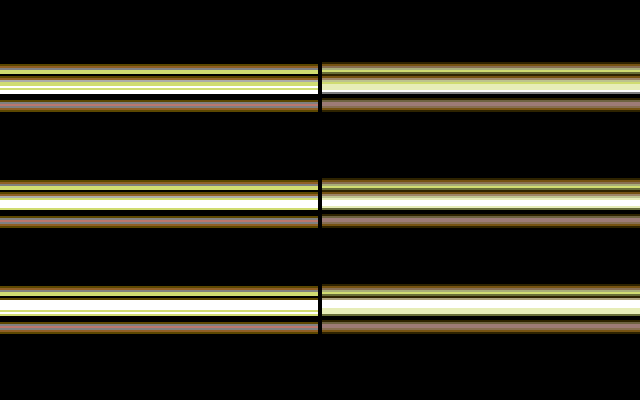

# RAYBARS: ray-traced raster bars for the C64

Three chrome cylinders orbit the screen's X axis. Each one is shaded every
frame with a diffuse term, a 1-D environment map and a Phong specular
highlight from a single point light. The CPU only has to write one
register per scanline, so almost all of its time goes to the shading maths.



## Build and run

```sh
python3 gen_tables.py                                   # optional: tables.inc and ramps.inc are committed
cl65 -t none -C raybars.cfg -o raybars.prg raybars.s   # STYLE=2 (default) gold; --asm-define STYLE=0 or 1 for the shaded looks
x64sc raybars.prg                                        # VICE, PAL machine
```

`simulate.py` runs the real binary's per-frame tracer on an emulated 6502
(`pip install py65 pillow`, and build with `-g -Ln raybars.lbl`). It checks
the cycle budget and the 63-cycle raster loop, and renders `preview.gif` and
`preview.png`. The GIF's left half shows the raw scanlines. The right half
roughly approximates how a PAL TV blends neighbouring lines. The preview
uses VICE's default palette, the one the article uses.

## How it works, step by step

1. **A raster bar is a cylinder seen side-on.** In the y/z plane each scanline
   `i` of a bar with radius `R` is a point on a circle, and its normal is at
   angle `t_i` where `sin t_i = (i + 0.5 - R) / R`. That depends only on `i`,
   so the normals of every bar make up one constant 32-byte table.
2. **The camera is at infinity (orthographic).** The view vector is always
   `(0,0,1)`, so there is no perspective divide and V never needs computing.
3. **Angles are stored in brads** (256 to a circle). Sums of angles wrap
   naturally in 8 bits, and every trig function is a 256-byte table.
4. **The lighting reduces to sums of angles.** With the light at angle `p`:
   * diffuse: `N·L = cos(t − p)`
   * specular: the reflected light, dotted with V, raised to the power n, which is `cos(2t − p)^n`
   * environment: the reflected view ray points at angle `2t`, so the lookup is `env[2t + spin]`
5. **The light uses a log-table atan2.** There is one light, at fixed depth
   `LZ = 100`. The bars orbit with |y| ≤ 64 and |z| ≤ 40, and the light bobs
   ±44, so `dy` always fits in a signed byte and `dz` is always 60..140. Then
   `atan(dy/dz) = atan(2^(log2 dy − log2 dz))`, which turns the division into
   a subtraction. It is evaluated once per bar, at the bar's axis, which
   works because R = 16 is small next to the light distance.
6. **Indexing uses doubled, page-aligned tables.** The tables are 512 bytes
   each, so `table[t − p]` becomes `lda table+(−p),x`, with `−p` patched into
   the operand once per bar. The inner loop takes about 39 cycles per
   scanline.
7. **Colour uses a stretched palette.** This follows Daniel Krajzewicz's
   [Stretching the c64 Palette](https://www.krajzewicz.de/blog/stretching-the-c64-palette.php).
   * **Multichrome ramps.** Each ramp takes one colour from each of the
     VIC-II's brightness levels, whatever its hue, so it gets every
     brightness step the chip has. These are three of the article's
     gradients, with their white end dropped:
     * Ocean: blue, dark grey, purple, light blue, cyan, light green
     * Forest: brown, dark grey, orange, green, light grey, light green
     * Dusk: blue, dark grey, purple, light red, cyan, yellow
   * **`STYLE=2` (default): the gold bar.** No shading of the bar colours
     at all. Each bar is 24 lines with a fixed hand-picked gold pattern, one
     colour per scanline, top to bottom:
     `9 8 12 7 7 0 9 8 15 7 7 1 7 1 7 0 0 0 9 12 10 12 8 9`.
     It works like a fixed environment map, so it doesn't shift as the bar
     moves. Only the white specular highlight is traced on top. Where the
     highlight is faint, white replaces gold on every other line
     (yellow/white alternating blends to light yellow). Where it is strong,
     it's solid white. The highlight covers every line, the black ones
     included. This style uses about 48% of the vblank.
   * **`STYLE=0`: dithering only where white used to be.** The
     bar's own colours are solid bands. Between the brightest bar colour
     and the white highlight, the two alternate on even and odd scanlines
     (the article's "Poor Man's Dithering"), which a PAL TV blends. The
     shading loop is unrolled by two, so even and odd lines read their own
     ramp table. `FLICKER=1` also swaps the pair every frame, which looks
     smoother on a sharp LCD or emulator but flickers.
   * **`STYLE=1`: the article's "scaled split".** Two lines of colour,
     then one black line, counted outwards from each bar's centre. The
     black lines belong to the bar, so they also cover the bars behind it.
   * **Correct widths.** The article notes that hand-made patterns never
     give each brightness its correct width. Here the widths come from the
     cosine shading, so the bars actually look round.
   * **Intensity** is diffuse (0..14) + env (0..2) + specular (0..8).
     Diffuse plus env tops out at 16, the brightest bar colour, so only the
     specular term reaches **white**.
8. **Bars are drawn back to front.** A 3-element sorting network orders them
   by depth, and the painter's algorithm handles the crossings.
9. **The screen is blanked (DEN=0).** With the display off there are no
   badlines, so after a double-IRQ stable raster the display is a plain
   63-cycle loop writing `$d020`, and the whole screen is border. The tracer
   uses about 5,000 of the roughly 6,800 vblank cycles (73%).

## GOLDTILT: one slanted gold bar

`goldtilt.s` is a separate program: one gold bar that bobs up and down and
rocks like a see-saw.

```sh
cl65 -t none -C raybars.cfg -o goldtilt.prg goldtilt.s
python3 sim_goldtilt.py      # needs -g -Ln goldtilt.lbl; renders preview_goldtilt.gif
```

* **Splitting each line.** A raster bar normally can't slant, because the
  colour only changes where the CPU writes `$d020`. Here every line of the
  bar is split into 6 segments. Each split is `lda #c / sta $d020 / nop`,
  8 cycles or 64 pixels, so 6 segments cover the whole 384-pixel visible
  line. The fastest possible split is 6 cycles (48 pixels), but six of
  those would only cover 288 pixels, leaving the last segment stretched.
* **The slant.** Segment *k* is drawn shifted down by `off_k` = 0..5
  lines, so the bar becomes a staircase that reads as one slanted bar. The
  slope follows `off_k = round(2.5 + (k - 2.5) * sin(tilt))`.
* **Black padding.** The gold column gets 6 black rows above and 6 below,
  so every segment is the same 36-entry column read at a different shift:
  `colour(row r, segment k) = column[r + 6 - off_k]`.
* **Speedcode.** The 30 display rows are unrolled code with no branches,
  exactly 63 cycles per row. Each frame, an unrolled patcher rewrites the
  180 `lda #` values in it.
* **The rest of the screen** is black, so the stable double IRQ simply
  fires 2 lines above wherever the bar is. The per-frame work uses at most
  about 16% of the time before the next IRQ.
* **The highlight** is traced exactly as in `STYLE=2`. Its dither follows
  each segment's own screen lines.
* **Horizontal position.** Where the splits land across the screen depends
  on exact cycle timing that only a real C64 or VICE shows. Use `HTUNE` to
  slide them so the first split falls in the horizontal blank.

## Tuning notes

* PAL only: the loop is 63 cycles per line, and an NTSC frame has too little vblank.
* `HTUNE` adds NOPs after the stable-raster code. If you see a step where
  the colour changes partway across a line, adjust it until the switch
  falls inside horizontal blank.
* Everything else (`R`, the orbit amplitudes, the light depth, the Phong
  exponent and the env map) is in `gen_tables.py` and at the top of `raybars.s`.
  Keep `R` in sync between the two files.
